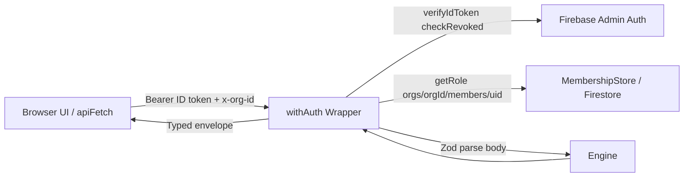
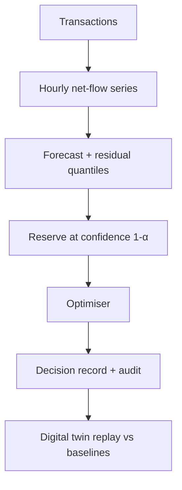

# Architecture

## Components
| Component | Responsibility | Location |
|---|---|---|
| UI | Pages, charts, tables; no financial logic | `src/app`, `src/components` |
| Engine | Pure TS: money, forecast, reserve, optimiser, simulator | `src/engine` (no React/Firebase imports) |
| API | Route Handlers: auth, Zod validation, call engine, persist | `src/app/api/**/route.ts` |
| Data access | Firestore repositories (server only, Admin SDK) | `src/server` |
| Client auth | Firebase Auth web SDK (sign-in only) | `src/lib/firebase-client.ts` |

## Boundaries
The browser never holds Admin credentials. The engine has no I/O so it is unit-testable and reusable by scripts. Route Handlers are thin adapters.

## API design
Engine routes:
- `POST /api/engine/generate` (minimum role: `analyst`)
- `POST /api/engine/forecast` (minimum role: `analyst`)
- `POST /api/engine/decision` (minimum role: `analyst`)

Responses use a typed envelope:
- Success: `{ ok: true, data: ... }` (or route-specific success payload preserving engine output structure)
- Failure: `{ ok: false, error: { code: "UNAUTHENTICATED" | "FORBIDDEN" | "VALIDATION_ERROR" | "INTERNAL", message: string, details?: unknown } }`

All incoming payloads are strictly validated using Zod; money amounts cross the wire as integer strings in minor units (cents). Header `x-org-id` is required and validated against charset and length constraints.

## Auth & Authorisation (Phase 14)

### Authentication Flow
1. **Client**: Authenticates via Firebase Auth (email/password or Google). The client-side wrapper in `src/lib/api-client.ts` (`apiFetch`) retrieves the JWT ID token using `getIdToken()`, and attaches it as `Authorization: Bearer <idToken>` alongside the `x-org-id` header.
2. **Fail-Fast Client Handling**: When the user is signed out or operating in mock mode, `getIdToken()` resolves to `null`. In this state, `apiFetch` immediately returns a typed `UNAUTHENTICATED` error envelope without making an invalid network round-trip.
3. **Token Refresh**: On receiving an HTTP 401 from any protected route, `apiFetch` attempts a single retry by requesting a forced token refresh (`getIdToken(true)`).

### Server-Side Route Guard (`withAuth`)
- Implemented in `src/server/with-auth.ts` wrapping route handlers with `withAuth(handler, { minRole })`.
- Guard validates `x-org-id` header format (alphanumeric, max 64 chars) using Zod.
- Verifies ID token with `verifyIdToken(token, true)` enforcing revocation checks (`checkRevoked: true`).
- Authorises organisation membership via `requireOrgMember` looking up `orgs/{orgId}/members/{uid}` with role hierarchy: `viewer` < `analyst` < `admin`.

> [!IMPORTANT]
> **Admin SDK Security Boundary**: The Firebase Admin SDK bypasses Firestore Security Rules completely. Route-level checks (`requireOrgMember` inside `withAuth`) constitute the true, authoritative authorization boundary for all engine APIs.

### Testability & Isolation
- Server auth components (`src/server/auth.ts`) declare interfaces: `TokenVerifier` and `MembershipStore`.
- Default implementations utilize `firebase-admin/auth` and `firebase-admin/firestore`.
- Test suites inject mock verifiers (`setTokenVerifier`) and stores (`setMembershipStore`) to run fast, deterministic Vitest checks without needing live Firebase infrastructure.
- Server-only modules use `import "server-only"` to prevent leakage into client bundles.

### Fail-Closed Mock Mode in Production
- Mock authentication is strictly disabled in production (`NODE_ENV === "production"`) unless `NEXT_PUBLIC_ALLOW_MOCK_AUTH=true` is set explicitly.
- In production without configured Firebase credentials, the login page displays a dedicated "Authentication is not configured" error panel, completely suppressing mock login and demo persona buttons.

## Data flow

## Errors
All route failures return the typed envelope `{ ok: false, error: { code, message, details? } }`:
- `400`: `VALIDATION_ERROR` (Zod validation failure on body or `x-org-id` header)
- `401`: `UNAUTHENTICATED` (missing, malformed, expired, or revoked token)
- `403`: `FORBIDDEN` (user is not an active member of the requested org or has insufficient role)
- `500`: `INTERNAL` (generic message: "An unexpected internal server error occurred."; internal stack traces and secrets are never exposed to clients, logged server-side only)

## Data Access Layer (Phase 15)

Implemented under `src/server/repositories/` using Firebase Admin Firestore, guarded by `import "server-only"`.

### Key Characteristics
1. **Multi-Tenant Path Scoping**: All collection paths are scoped under `orgs/{orgId}/<collection>/<id>`. Function inputs require explicit `orgId` and strictly validate IDs against `^[A-Za-z0-9_-]{1,64}$` to prevent path traversal vulnerabilities.
2. **Runtime Validation & Converters**: Document schemas (`src/server/repositories/schemas.ts`) validate reads and writes with Zod. Corrupt or unexpected schemas trigger a typed `RepositoryError("MALFORMED_DATA")`.
3. **Lossless Money Serialization**: Balances and minor-unit amounts are stored as decimal strings (`amountMinor`, `capacityMinor`, `reserveMinor`, `surplusMinor`, `inMinor`, `outMinor`, `expectedNetYieldMinor`). Converted to/from immutable `Money` instances at repository boundaries, preventing IEEE 754 precision degradation for numbers exceeding $2^{53}$.
4. **UTC Timestamping**: Storage uses Firestore `Timestamp` in UTC, converted to standard JavaScript `Date` in domain entities. `createdAt` and `createdBy` are injected automatically by repositories.
5. **Batch Chunking**: `transactionsRepo.batchInsert` partitions writes into batches of $\le 500$ writes, respecting Firestore's hard batch limit.
6. **Immutable Audit Trail**: `auditRepo` exposes only `append`, `get`, and `list` methods. It intentionally does not provide `update` or `delete` methods.
7. **Injectable Handles**: Repositories accept an optional `firestore?: Firestore` instance, defaulting to `getAdminFirestore()` (which supports in-memory stub injection via `setAdminFirestore`).

## Deployment
Vercel hosts the Next.js app; Firebase hosts Auth/Firestore. Secrets in Vercel env vars (`FIREBASE_SERVICE_ACCOUNT_JSON`). Function limits per [Vercel docs](https://vercel.com/docs/functions/limitations): keep each run well under 300 s and 4.5 MB payload.

## Current Implementation Status
Phases 1 through 15 are complete: pure TypeScript engine (money, forecast, reserve, optimizer, decision), Route Handlers (`/api/engine/*`), Firebase client authentication with mock fallback and route guards, Firebase Admin SDK integration, route-level org authorisation, client API fetch plumbing, typed Firestore repositories, security rules, composite indexes, and repository unit tests.
