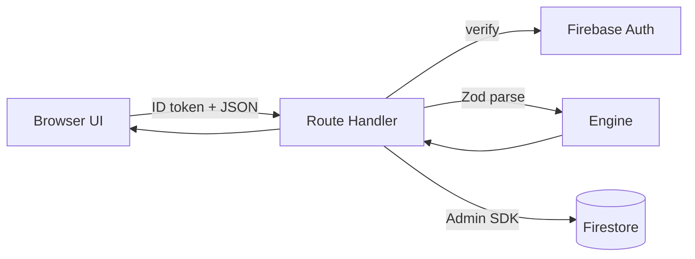
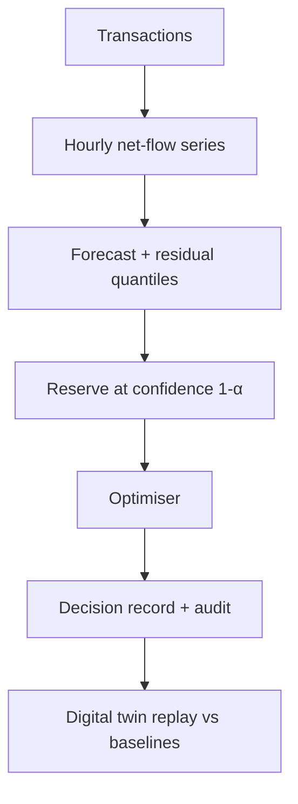

# Architecture

## Components
| Component | Responsibility | Location |
|---|---|---|
| UI | Pages, charts, tables; no financial logic | `src/app`, `src/components` |
| Engine | Pure TS: money, forecast, reserve, optimiser, simulator | `src/engine` (no React/Firebase imports) |
| API | Route Handlers: auth, Zod validation, call engine, persist | `src/app/api/**/route.ts` |
| Data access | Firestore repositories (server only, Admin SDK) | `src/server` |
| Client auth | Firebase Auth web SDK (sign-in only) | `src/lib/firebase-client.ts` |

## Boundaries
The browser never holds Admin credentials. The engine has no I/O so it is unit-testable and reusable by scripts. Route Handlers are thin adapters.

## API design (planned)
`POST /api/forecast`, `POST /api/reserve`, `POST /api/optimize`, `POST /api/simulate`, `GET /api/decisions`. Responses use a typed envelope `{ ok: true, data } | { ok: false, error: { code, message } }`. All inputs validated with Zod; money crosses the wire as integer strings (minor units).

## Auth
Client signs in with Firebase Auth; sends the ID token as `Authorization: Bearer`. The server verifies it with the Admin SDK and checks org membership. Because the Admin SDK bypasses Firestore rules (verified in Firebase docs), authorisation is enforced in route code; rules additionally protect any direct client access.

## Data flow

## Errors
Engine throws typed errors; routes map them to `{ok:false}` with stable codes and never leak stack traces or secrets. UI has loading, empty and error states.

## Deployment
Vercel hosts the Next.js app; Firebase hosts Auth/Firestore. Secrets in Vercel env vars. Function limits per [Vercel docs](https://vercel.com/docs/functions/limitations): keep each run well under 300 s and 4.5 MB payload.

## Phase-1 reality
Only the UI shell with labelled sample data exists. Firebase, API and engine are not yet implemented.
