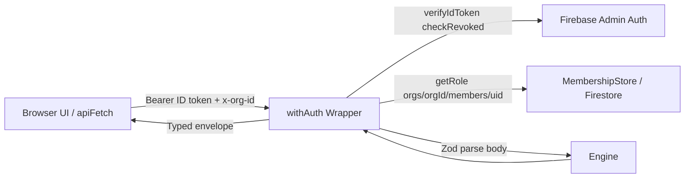
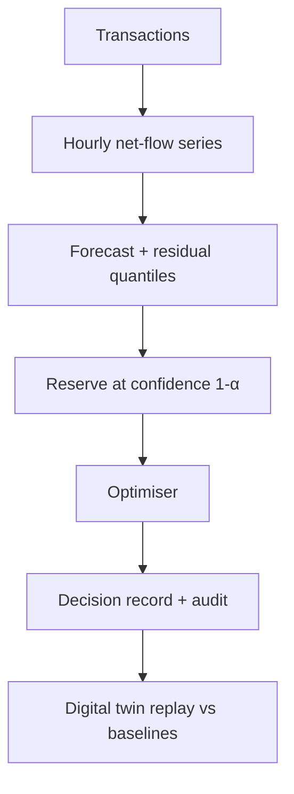

# Architecture

## Components
| Component | Responsibility | Location |
|---|---|---|
| UI | Pages, charts, tables; no financial logic | `src/app`, `src/components` |
| Engine | Pure TS: money, forecast, reserve, optimiser, simulator | `src/engine` (no React/Firebase imports) |
| API | Route Handlers: auth, Zod validation, call engine, persist | `src/app/api/**/route.ts` |
| Data access | Firestore repositories (server only, Admin SDK) | `src/server` |
| Client auth | Firebase Auth web SDK (sign-in only) | `src/lib/firebase-client.ts` |

## Boundaries
The browser never holds Admin credentials. The engine has no I/O so it is unit-testable and reusable by scripts. Route Handlers are thin adapters.

## API design
Engine routes:
- `POST /api/engine/generate` (minimum role: `analyst`)
- `POST /api/engine/forecast` (minimum role: `analyst`)
- `POST /api/engine/decision` (minimum role: `analyst`)

Responses use a typed envelope:
- Success: `{ ok: true, data: ... }` (or route-specific success payload preserving engine output structure)
- Failure: `{ ok: false, error: { code: "UNAUTHENTICATED" | "FORBIDDEN" | "VALIDATION_ERROR" | "INTERNAL", message: string, details?: unknown } }`

All incoming payloads are strictly validated using Zod; money amounts cross the wire as integer strings in minor units (cents). Header `x-org-id` is required and validated against charset and length constraints.

## Auth & Authorisation (Phase 14)

### Authentication Flow
1. **Client**: Authenticates via Firebase Auth (email/password or Google). The client-side wrapper in `src/lib/api-client.ts` (`apiFetch`) retrieves the JWT ID token using `getIdToken()`, and attaches it as `Authorization: Bearer <idToken>` alongside the `x-org-id` header.
2. **Fail-Fast Client Handling**: When the user is signed out or operating in mock mode, `getIdToken()` resolves to `null`. In this state, `apiFetch` immediately returns a typed `UNAUTHENTICATED` error envelope without making an invalid network round-trip.
3. **Token Refresh**: On receiving an HTTP 401 from any protected route, `apiFetch` attempts a single retry by requesting a forced token refresh (`getIdToken(true)`).

### Server-Side Route Guard (`withAuth`)
- Implemented in `src/server/with-auth.ts` wrapping route handlers with `withAuth(handler, { minRole })`.
- Guard validates `x-org-id` header format (alphanumeric, max 64 chars) using Zod.
- Verifies ID token with `verifyIdToken(token, true)` enforcing revocation checks (`checkRevoked: true`).
- Authorises organisation membership via `requireOrgMember` looking up `orgs/{orgId}/members/{uid}` with role hierarchy: `viewer` < `analyst` < `admin`.

> [!IMPORTANT]
> **Admin SDK Security Boundary**: The Firebase Admin SDK bypasses Firestore Security Rules completely. Route-level checks (`requireOrgMember` inside `withAuth`) constitute the true, authoritative authorization boundary for all engine APIs.

### Testability & Isolation
- Server auth components (`src/server/auth.ts`) declare interfaces: `TokenVerifier` and `MembershipStore`.
- Default implementations utilize `firebase-admin/auth` and `firebase-admin/firestore`.
- Test suites inject mock verifiers (`setTokenVerifier`) and stores (`setMembershipStore`) to run fast, deterministic Vitest checks without needing live Firebase infrastructure.
- Server-only modules use `import "server-only"` to prevent leakage into client bundles.

### Fail-Closed Mock Mode in Production
- Mock authentication is strictly disabled in production (`NODE_ENV === "production"`) unless `NEXT_PUBLIC_ALLOW_MOCK_AUTH=true` is set explicitly.
- In production without configured Firebase credentials, the login page displays a dedicated "Authentication is not configured" error panel, completely suppressing mock login and demo persona buttons.

## Data flow

## Errors
All route failures return the typed envelope `{ ok: false, error: { code, message, details? } }`:
- `400`: `VALIDATION_ERROR` (Zod validation failure on body or `x-org-id` header)
- `401`: `UNAUTHENTICATED` (missing, malformed, expired, or revoked token)
- `403`: `FORBIDDEN` (user is not an active member of the requested org or has insufficient role)
- `500`: `INTERNAL` (generic message: "An unexpected internal server error occurred."; internal stack traces and secrets are never exposed to clients, logged server-side only)

## Data Access Layer (Phase 15)

Implemented under `src/server/repositories/` using Firebase Admin Firestore, guarded by `import "server-only"`.

### Key Characteristics
1. **Multi-Tenant Path Scoping**: All collection paths are scoped under `orgs/{orgId}/<collection>/<id>`. Function inputs require explicit `orgId` and strictly validate IDs against `^[A-Za-z0-9_-]{1,64}$` to prevent path traversal vulnerabilities.
2. **Runtime Validation & Converters**: Document schemas (`src/server/repositories/schemas.ts`) validate reads and writes with Zod. Corrupt or unexpected schemas trigger a typed `RepositoryError("MALFORMED_DATA")`.
3. **Lossless Money Serialization**: Balances and minor-unit amounts are stored as decimal strings (`amountMinor`, `capacityMinor`, `reserveMinor`, `surplusMinor`, `inMinor`, `outMinor`, `expectedNetYieldMinor`). Converted to/from immutable `Money` instances at repository boundaries, preventing IEEE 754 precision degradation for numbers exceeding $2^{53}$.
4. **UTC Timestamping**: Storage uses Firestore `Timestamp` in UTC, converted to standard JavaScript `Date` in domain entities. `createdAt` and `createdBy` are injected automatically by repositories.
5. **Batch Chunking**: `transactionsRepo.batchInsert` partitions writes into batches of $\le 500$ writes, respecting Firestore's hard batch limit.
6. **Immutable Audit Trail**: `auditRepo` exposes only `append`, `get`, and `list` methods. It intentionally does not provide `update` or `delete` methods.
7. **Injectable Handles**: Repositories accept an optional `firestore?: Firestore` instance, defaulting to `getAdminFirestore()` (which supports in-memory stub injection via `setAdminFirestore`).

## Persistence & Audit Trail (Phase 16)

### Route-Level Persistence Flow
Each successful execution in `/api/engine/forecast`, `/api/engine/decision`, and `/api/engine/generate` persists the computed result using the Phase 15 Firestore repositories and records an append-only audit log:
1. **Forecasts**: `forecastsRepo.create` persists method, parameters, cutoff timestamp (`asOf`), horizon, predicted points, and residual quantiles/backtest metrics.
2. **Decisions**: `decisionsRepo.create` stores `forecastId` link, statistical confidence level, required reserve, deployable surplus, individual instrument allocations, operational status (`HEALTHY`, `UNDER_RESERVED`, `LOW_CONFIDENCE`), expected net yield, and human-readable explanation.
3. **Audit Hashes**: Every persisted record generates an immutable audit record via `auditRepo.append` capturing:
   - `actorUid`: ID of the authenticated user invoking the route.
   - `action`: e.g. `"forecast.create"`, `"decision.create"`, `"transactions.generate"`.
   - `refPath`: Full Firestore document path (`orgs/{orgId}/decisions/{id}`).
   - `afterHash`: Deterministic SHA-256 hash computed over recursively key-sorted canonical JSON (`canonicalJsonHash`), ensuring tamper-evident immutability.
4. **Persistence Failure Policy**: If computation succeeds but Firestore persistence fails, routes return HTTP 200 with `persisted: false`, `audited: false`, and a generic warning (`warning`), keeping detailed errors server-side only. If document persistence succeeds but audit logging fails, `persisted: true` and `audited: false` are surfaced.

### Read Endpoints
- `GET /api/decisions`: Lists decisions ordered newest first with bounded pagination (`limit` query param, clamped between 20 and 100). Minimum role: `viewer`.
- `GET /api/decisions/[id]`: Retrieves a single decision record by ID within the authenticated organisation. Minimum role: `viewer`.
- **JSON-Safe Serialization**: Repositories convert immutable `Money` instances to decimal string minor units, preventing raw BigInt serialization failures in `JSON.stringify`.

## Design System & Theming (Phase 16)

### Dual-Theme Mechanism
- Controlled via `data-theme="dark" | "light"` on `<html>`.
- Zero-dependency inline script in `<head>` of `src/app/layout.tsx` inspects `localStorage.getItem("reserve-juggler.theme")` and falls back to `prefers-color-scheme`, eliminating flash of unstyled content (anti-FOUC).
- Wrapped in try/catch to gracefully tolerate restricted storage contexts (e.g. private browsing).

### Palette Specifications
- **Dark Theme**: Navy surfaces (`#0a101d`, `#0e1628`, `#152238`), thin borders (`#212c45`), sky blue accent (`#38bdf8`), subtle amber reserve highlight, and emerald surplus tones.
- **Light Theme**: Soft warm off-white background (`#f3f1ec`), surface (`#faf9f6`), secondary surface (`#efece5`), soft borders (`#ded9cd`), deep navy ink text (`#1d2638`), and muted text (`#667085`), meeting WCAG AA contrast without harsh contrast.
- **Chart Theming**: Recharts SVG props consume dynamic theme tokens via `useChartTheme()`, providing responsive stroke, fill, and tooltip contrast in both themes.

## Dashboard Integration & Run Contract (Phase 17)

### Summary & Run Endpoints
1. **`GET /api/dashboard/summary`**:
   - Minimum role: `viewer` (authenticated via `withAuth`).
   - Retrieves latest persisted `decision` and `forecast` for the authenticated organisation in a single typed envelope `{ ok: true, data: DashboardSummaryPayload }`.
   - Returns `{ forecast: null, decision: null, actuals: [] }` when no runs have been executed yet (not an HTTP error).
   - Exposes `userRole` (`admin` | `analyst` | `viewer`) to enable role-based UI capabilities on the client.
2. **`POST /api/dashboard/run`**:
   - Minimum role: `analyst` (viewers receive 403 Forbidden).
   - Executes end-to-end generate &rarr; forecast &rarr; decision pipeline using org-scoped instruments from `instrumentsRepo`.
   - If no instruments are configured in Firestore for the org, returns a 400 `VALIDATION_ERROR` requiring instruments to be configured rather than using hidden fallback defaults.
   - Enforces a 10-second per-org debouncing / rate limit, returning HTTP 429 with `{ error: { code: "RATE_LIMITED", message: "...", details: { retryAfterSeconds: 10 } } }` and standard `Retry-After: 10` header.
   - Persists forecast, decision, series buckets, and immutable SHA-256 audit log entries with matching identifiers.
   - Requests with `source: "synthetic"` explicitly mark stored records with `source: "synthetic"`, allowing the UI to accurately label the origin.
   - Returns the updated `DashboardSummaryPayload` directly to the client.

### Client Data Flow (`useDashboardData` Hook)
- **Lifecycle & State Machine**: State transitions through `"loading"` &rarr; `"ready"` | `"empty"` | `"error"` | `"unauthenticated"`.
- **Cancellation & Unmount Safety**: Uses ref-tracking to discard in-flight responses if the component unmounts before response resolution.
- **Strict Data Honesty**:
  - In mock mode (`isMock`) or when unauthenticated, no network requests are dispatched. The dashboard renders labelled sample data alongside a prominent "Demonstration Mode" banner and a "Sample data" badge.
  - Live mode renders strictly stored values from the backend engine: stored `availableCash` (avoiding false derivations like `reserve + surplus`), real quantile uncertainty bands, true backtest MASE and sample sizes, and real instrument names, APYs, penalties, and utilisation percentages calculated via exact BigInt arithmetic (`calculateAllocationPercentage`).
  - Live and sample data are never mixed in a single view.
- **Role-Based Controls**: The "Run engine" action is visible only to `analyst` and `admin` roles, and is hidden completely for users with `viewer` permissions.

## Deployment
Vercel hosts the Next.js app; Firebase hosts Auth/Firestore. Secrets in Vercel env vars (`FIREBASE_SERVICE_ACCOUNT_JSON`). Function limits per [Vercel docs](https://vercel.com/docs/functions/limitations): keep each run well under 300 s and 4.5 MB payload.

## Current Implementation Status
Phases 1 through 17 are complete: pure TypeScript engine (money, forecast, reserve, optimizer, decision), Route Handlers (`/api/engine/*`), Firebase client authentication with mock fallback and route guards, Firebase Admin SDK integration, route-level org authorisation, client API fetch plumbing, typed Firestore repositories, security rules, composite indexes, route persistence with SHA-256 audit logs, decision read endpoints (`/api/decisions`), dual-theme system (dark + soft off-white), and full dashboard wiring (`/api/dashboard/summary`, `/api/dashboard/run`, `useDashboardData`). Tested with 263 Vitest unit/integration tests and visual browser subagent verification across desktop and mobile form factors.
